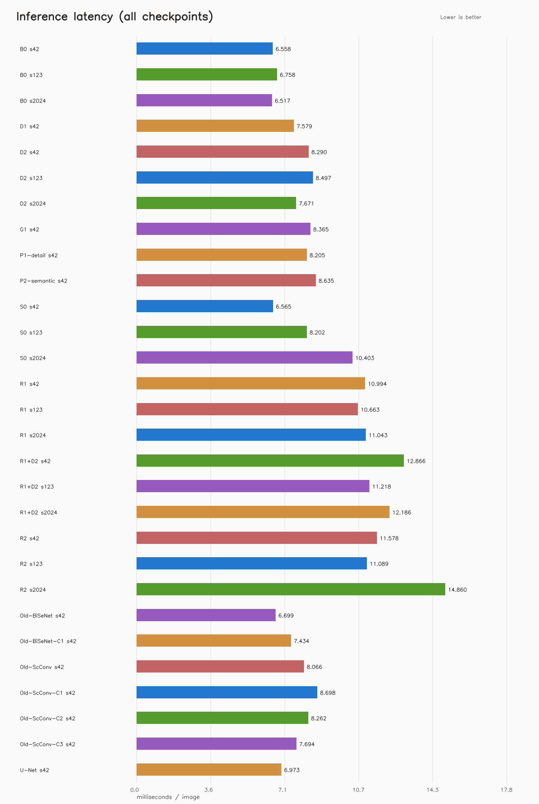
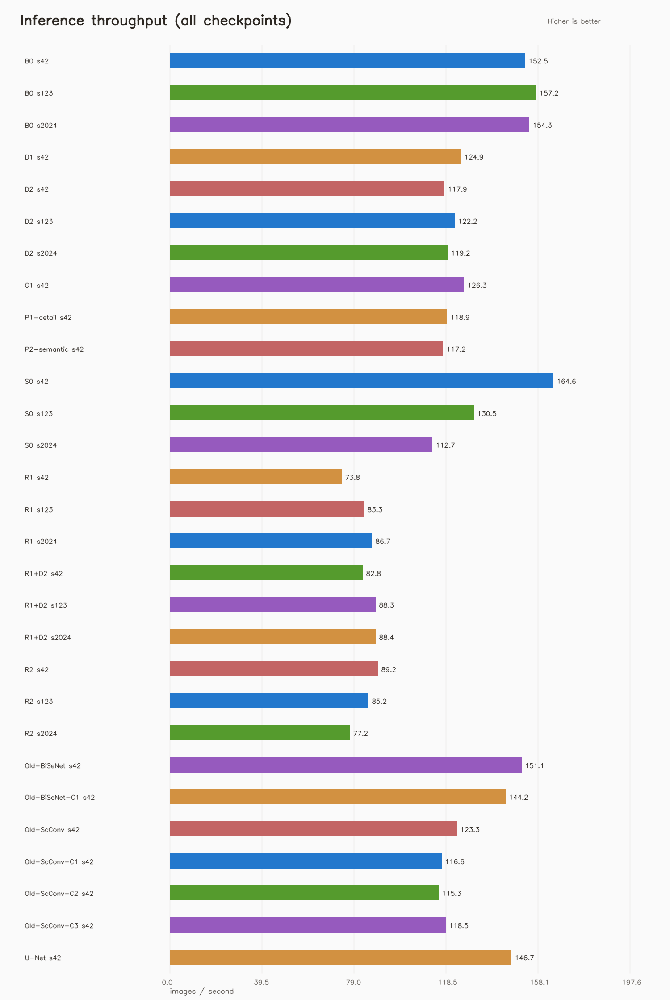

# 所有已训练模型推理速度对比

> 生成时间：2026-10-20 12:43:37  
> 扫描到 29 个 checkpoint，成功测速 29 个；设备：`cuda` / NVIDIA GeForce RTX 3050 Laptop GPU；PyTorch：`2.6.0+cu124`；CUDA：`12.4`。  
> 输入：`1×3×200×200`；AMP：`off`；报告按每个 run 的 `best.pth` 分别列出。

## 逐模型结果

| 实验臂/模型 | ScConv应用方式 | 种子 | run 目录 | best epoch | 平均延迟 (ms/张) | P50 | P95 | 吞吐 (张/秒，均值±SD) | 参数量 | 峰值额外显存 (MiB) |
|---|---|---:|---|---:|---:|---:|---:|---:|---:|---:|
| B0 基线 | ScConv 关闭（BiSeNetV2 基线） | 42 | `bisenetv2_ablation_B0_baseline/NEU_90_0` | 83 | 6.558 | 6.351 | 8.104 | 152.55 ± 1.94 | 3,622,820 | 8.8 |
| B0 基线 | ScConv 关闭（BiSeNetV2 基线） | 123 | `bisenetv2_ablation_B0_baseline/NEU_90_1` | 88 | 6.758 | 6.417 | 9.829 | 157.21 ± 6.89 | 3,622,820 | 8.8 |
| B0 基线 | ScConv 关闭（BiSeNetV2 基线） | 2024 | `bisenetv2_ablation_B0_baseline/NEU_90_2` | 89 | 6.517 | 6.414 | 7.549 | 154.34 ± 3.90 | 3,622,820 | 8.8 |
| D1 残差 scale1 | 附加 fused，残差 scale=1 | 42 | `bisenetv2_ablation_D1_scale1/NEU_90_0` | 86 | 7.579 | 7.257 | 9.740 | 124.88 ± 4.89 | 3,652,901 | 8.8 |
| D2 fused 直连 | 附加 fused，无残差 | 42 | `bisenetv2_ablation_D2_direct/NEU_90_0` | 90 | 8.290 | 7.912 | 11.450 | 117.90 ± 11.37 | 3,652,900 | 8.8 |
| D2 fused 直连 | 附加 fused，无残差 | 123 | `bisenetv2_ablation_D2_direct/NEU_90_1` | 89 | 8.497 | 8.038 | 12.202 | 122.24 ± 3.21 | 3,652,900 | 8.8 |
| D2 fused 直连 | 附加 fused，无残差 | 2024 | `bisenetv2_ablation_D2_direct/NEU_90_2` | 85 | 7.671 | 7.522 | 9.389 | 119.22 ± 7.03 | 3,652,900 | 8.8 |
| G1 门控修正 | 附加 fused，残差 scale=0.1；SRU gamma 归一化关闭 | 42 | `bisenetv2_ablation_G1_gate_fix/NEU_90_0` | 86 | 8.365 | 8.070 | 10.500 | 126.31 ± 5.40 | 3,652,901 | 8.8 |
| P1 detail 插入 | 附加 detail，残差 scale=0.1 | 42 | `bisenetv2_ablation_P1_detail/NEU_90_0` | 83 | 8.205 | 7.697 | 12.407 | 118.94 ± 5.35 | 3,652,901 | 8.8 |
| P2 semantic 插入 | 附加 semantic，残差 scale=0.1 | 42 | `bisenetv2_ablation_P2_semantic/NEU_90_0` | 90 | 8.635 | 7.986 | 12.070 | 117.23 ± 16.16 | 3,652,901 | 8.8 |
| S0 fused 残差 | 附加 fused，残差 scale=0.1 | 42 | `bisenetv2_ablation_S0_scconv_fused/NEU_90_0` | 90 | 6.565 | 5.793 | 11.560 | 164.64 ± 11.86 | 3,652,901 | 8.8 |
| S0 fused 残差 | 附加 fused，残差 scale=0.1 | 123 | `bisenetv2_ablation_S0_scconv_fused/NEU_90_1` | 89 | 8.202 | 7.581 | 12.598 | 130.47 ± 2.53 | 3,652,901 | 8.8 |
| S0 fused 残差 | 附加 fused，残差 scale=0.1 | 2024 | `bisenetv2_ablation_S0_scconv_fused/NEU_90_2` | 90 | 10.403 | 9.234 | 17.989 | 112.68 ± 16.86 | 3,652,901 | 8.8 |
| R1 detail 替换 | 替换 detail.repeat（保留 ReLU） | 42 | `bisenetv2_repl_R1_detail/NEU_90_0` | 87 | 10.994 | 10.305 | 15.476 | 73.77 ± 4.48 | 3,328,804 | 9.5 |
| R1 detail 替换 | 替换 detail.repeat（保留 ReLU） | 123 | `bisenetv2_repl_R1_detail/NEU_90_1` | 87 | 10.663 | 10.233 | 14.643 | 83.25 ± 2.70 | 3,328,804 | 9.5 |
| R1 detail 替换 | 替换 detail.repeat（保留 ReLU） | 2024 | `bisenetv2_repl_R1_detail/NEU_90_2` | 87 | 11.043 | 10.328 | 15.320 | 86.71 ± 5.92 | 3,328,804 | 9.5 |
| R1+D2 组合 | 附加 fused，无残差；替换 detail.repeat（保留 ReLU） | 42 | `bisenetv2_repl_R1_plus_D2/NEU_90_0` | 88 | 12.866 | 12.194 | 19.034 | 82.81 ± 7.70 | 3,358,884 | 9.5 |
| R1+D2 组合 | 附加 fused，无残差；替换 detail.repeat（保留 ReLU） | 123 | `bisenetv2_repl_R1_plus_D2/NEU_90_1` | 84 | 11.218 | 10.754 | 13.480 | 88.28 ± 1.20 | 3,358,884 | 9.5 |
| R1+D2 组合 | 附加 fused，无残差；替换 detail.repeat（保留 ReLU） | 2024 | `bisenetv2_repl_R1_plus_D2/NEU_90_2` | 83 | 12.186 | 11.372 | 16.871 | 88.37 ± 0.63 | 3,358,884 | 9.5 |
| R2 semantic 替换 | 替换 semantic.ge_conv1（保留 ReLU） | 42 | `bisenetv2_repl_R2_semantic/NEU_90_0` | 89 | 11.578 | 10.640 | 17.239 | 89.20 ± 1.69 | 3,233,220 | 8.8 |
| R2 semantic 替换 | 替换 semantic.ge_conv1（保留 ReLU） | 123 | `bisenetv2_repl_R2_semantic/NEU_90_1` | 87 | 11.089 | 10.698 | 14.509 | 85.22 ± 1.34 | 3,233,220 | 8.8 |
| R2 semantic 替换 | 替换 semantic.ge_conv1（保留 ReLU） | 2024 | `bisenetv2_repl_R2_semantic/NEU_90_2` | 85 | 14.860 | 11.182 | 32.754 | 77.24 ± 7.49 | 3,233,220 | 8.8 |
| BiSeNetV2 | BiSeNetV2（未启用 ScConv） | 42 | `old/bisenetv2/NEU_300_0` | 223 | 6.699 | 6.086 | 10.647 | 151.13 ± 2.07 | 3,622,820 | 8.8 |
| BiSeNetV2 config1 | BiSeNetV2（未启用 ScConv） | 42 | `old/bisenetv2_config1/NEU_300_0` | 170 | 7.434 | 6.624 | 11.146 | 144.18 ± 13.84 | 3,622,820 | 8.8 |
| 旧版 ScConv | 附加 fused，残差 scale=0.1 | 42 | `old/bisenetv2_scconv/NEU_300_0` | 229 | 8.066 | 7.400 | 11.947 | 123.31 ± 7.61 | 3,652,901 | 8.8 |
| 旧版 ScConv config1 | 附加 fused，残差 scale=0.1 | 42 | `old/bisenetv2_scconv_config1/NEU_300_0` | 229 | 8.698 | 8.303 | 12.008 | 116.63 ± 12.58 | 3,652,901 | 8.8 |
| 旧版 ScConv config2 | 附加 fused，残差 scale=0.1 | 42 | `old/bisenetv2_scconv_config2/NEU_350_0` | 229 | 8.262 | 7.732 | 11.414 | 115.33 ± 3.77 | 3,652,901 | 8.8 |
| 旧版 ScConv config3 | 附加 fused，残差 scale=0.05 | 42 | `old/bisenetv2_scconv_config3/NEU_350_0` | 229 | 7.694 | 7.387 | 9.761 | 118.46 ± 9.87 | 3,652,901 | 8.8 |
| U-Net | U-Net 标准结构 | 42 | `old/unet/NEU_300_1` | 69 | 6.973 | 6.754 | 8.482 | 146.65 ± 4.34 | 7,849,700 | 46.8 |

## 测量设置

- 对 `results` 下每个 `best.pth` 单独重建网络并严格加载其对应权重；结构参数优先读取同目录 `config.json` 快照，因此 ScConv 的插入位置、残差、门控和替换方式均按该次训练配置还原。
- 输入固定为 1×3×200×200，预热 20 次。延迟每轮 50 次、共 3 轮；吞吐每轮 100 次、共 3 轮。
- CUDA 延迟使用 CUDA Event，CPU 延迟使用高精度计时；吞吐使用同步后的批量墙钟时间。GPU 默认 channels-last，所有模型设置一致。
- 显存为模型加载后推理前向期间的额外峰值分配量，不是整个进程或设备总占用；CPU 模式不提供显存值。
- 只测设备驻留输入上的网络前向，不含图像读取、预处理、CPU-GPU 传输、argmax/后处理。速度受设备负载、温度、功耗策略和其他进程影响。

## 结果稳定性

重复波动超过提示阈值（吞吐 CV >10% 或 P95/P50 >1.5）的模型，建议空闲 GPU 后复测，不要直接作为正式论文速度结论：
- `bisenetv2_ablation_B0_baseline/NEU_90_1`：吞吐 CV=4.4%，P95/P50=1.53
- `bisenetv2_ablation_D2_direct/NEU_90_1`：吞吐 CV=2.6%，P95/P50=1.52
- `bisenetv2_ablation_P1_detail/NEU_90_0`：吞吐 CV=4.5%，P95/P50=1.61
- `bisenetv2_ablation_P2_semantic/NEU_90_0`：吞吐 CV=13.8%，P95/P50=1.51
- `bisenetv2_ablation_S0_scconv_fused/NEU_90_0`：吞吐 CV=7.2%，P95/P50=2.00
- `bisenetv2_ablation_S0_scconv_fused/NEU_90_1`：吞吐 CV=1.9%，P95/P50=1.66
- `bisenetv2_ablation_S0_scconv_fused/NEU_90_2`：吞吐 CV=15.0%，P95/P50=1.95
- `bisenetv2_repl_R1_detail/NEU_90_0`：吞吐 CV=6.1%，P95/P50=1.50
- `bisenetv2_repl_R1_plus_D2/NEU_90_0`：吞吐 CV=9.3%，P95/P50=1.56
- `bisenetv2_repl_R2_semantic/NEU_90_0`：吞吐 CV=1.9%，P95/P50=1.62
- `bisenetv2_repl_R2_semantic/NEU_90_2`：吞吐 CV=9.7%，P95/P50=2.93
- `old/bisenetv2/NEU_300_0`：吞吐 CV=1.4%，P95/P50=1.75
- `old/bisenetv2_config1/NEU_300_0`：吞吐 CV=9.6%，P95/P50=1.68
- `old/bisenetv2_scconv/NEU_300_0`：吞吐 CV=6.2%，P95/P50=1.61
- `old/bisenetv2_scconv_config1/NEU_300_0`：吞吐 CV=10.8%，P95/P50=1.45

## 输出文件

- `speed_results.csv`：每个 checkpoint 一行的测速表。
- `speed_results.json`：结果、配置来源及环境参数。
- `latency_comparison.png`、`throughput_comparison.png`：本报告引用的逐 checkpoint 对比图。

> 不同种子 checkpoint 结构相同，速度理论上应接近；逐 run 测量主要用于完整覆盖结果目录和发现异常。正式比较时应在同一设备、空闲负载下重复测量。数据为模型前向速度，不等于端到端应用延迟。
